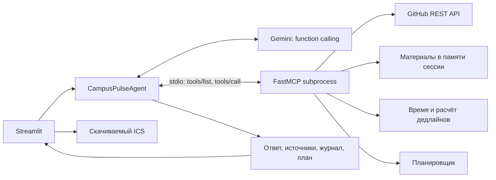

# Архитектура CampusPulse AI

В облачном режиме UI обращается к API `reasoningEngines:query`, а CampusPulseAgent и его MCP subprocess выполняются внутри Agent Engine. Этот вариант подготовлен, но ещё не развёрнут.

## Цикл агента

1. Клиент запускает новый MCP-процесс и выполняет initialize.
2. Документы загружаются в память процесса. Модель получает только названия документов до вызова поиска.
3. Схемы шести инструментов берутся через `tools/list`.
4. Gemini возвращает ответ или `function_call`.
5. Приложение вызывает соответствующий MCP-tool и добавляет `function_response` в диалог модели. Сохраняются thought signatures, но скрытый reasoning не выводится.
6. Цикл повторяется до ответа, лимита восьми шагов или таймаута. UI получает фактический журнал, а не имитацию действий.

## Инструменты и источники

| Tool | Источник / действие | Проверяемый результат |
|---|---|---|
| get_current_time | Системное время, IANA timezone | ISO timestamp и часовой пояс |
| calculate_deadline | Срок и текущее время | Оставшиеся минуты, признак просрочки |
| get_github_issues | GitHub REST API, live | Issues, URL, fetched_at, известный срок или null |
| read_github_readme | GitHub REST API, live | Текст README и URL источника |
| search_study_materials | Загруженные пользователем документы | Фрагменты и имена файлов |
| plan_study_week | Текущие задачи и ограничения | Блоки времени, допущения, нераспределённая работа |

## Планирование

Задачи сортируются по известному ближайшему сроку. Задачи без срока идут после них. Работа распределяется по учебным окнам до дедлайна, блоками до 60 минут. Начало не раньше текущего времени, округлённого вверх до 15 минут. Блоки не пересекают полночь или срок задачи. Просроченная работа и нехватка вместимости показываются отдельно.

Это воспроизводимый эвристический планировщик, без заявления о глобально оптимальном расписании.

## Границы доверия

- GitHub URL нормализуется до owner/repo. Произвольные серверы не принимаются.
- Содержимое файлов и GitHub считается данными. System instruction запрещает выполнять встроенные в них инструкции.
- Инструменты модели не могут запускать shell, отправлять сообщения или изменять сторонние ресурсы.
- Документы разных запросов находятся в разных subprocess, что проверяется тестом изоляции.
- Наличие prompt instruction не означает полной защиты от prompt injection. Для production нужны eval-наборы и дополнительные проверки политик.
- API-ключ передаётся только официальному Gemini endpoint. В MCP-процесс ключ Gemini и Google ADC не копируются.

## Соответствие кейсу № 2

| Требование | Реализация | Статус |
|---|---|---|
| Gemini-агент | google-genai + цикл function calling | Live-ответ получен |
| Реальный MCP / custom tools | Python FastMCP, stdio | Проверено локально |
| Внешние актуальные данные | GitHub API | Подключено, возможен anonymous rate limit |
| Минимальный UI и reasoning loop | Streamlit, журнал вызовов/результатов | Проверено |
| Vertex AI Agent Engine | ReasoningEngine.create + cloud client | Не развёрнут: нет активного биллинга |
| Код, MCP, deployment, README | В исходниках и архиве | Подготовлено |
| Презентация | output/presentation | Подготовлена отдельно |

Полное выполнение кейса требует успешного облачного deployment и удалённого smoke-теста. Локальный бесплатный Gemini API не заменяет это требование.
